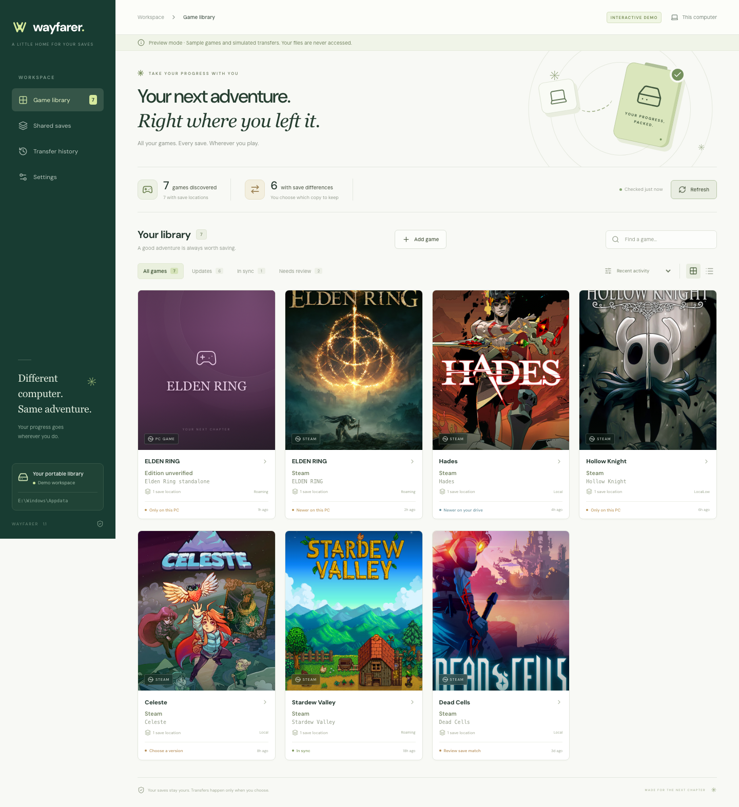
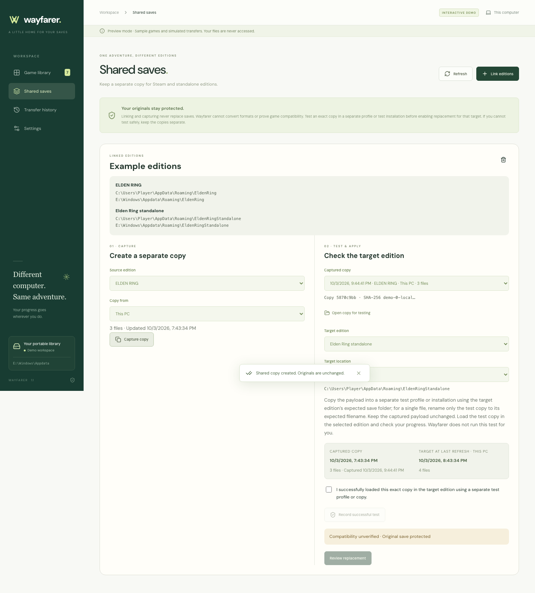

# Wayfarer

Take your game saves between Windows computers on an external drive. Wayfarer finds game installations, matches their AppData saves, and lets you compare and transfer progress in either direction.

**Version 1.1.1 · Windows 10/11 x64 · Portable, unsigned executable**



*Browser demo with sample data. Screenshots do not establish Windows runtime behavior or real-game compatibility.*

## What it does

| Feature | Behavior |
| --- | --- |
| Game discovery | Searches nested game folders and uses Steam manifests, installation metadata, and the bundled save catalog. |
| Save detection | Matches Local, LocalLow, and Roaming paths; supports manual game corrections and exact save file or folder selections. |
| Comparison | Shows modification times, file counts, and content differences; detects conflicting changes since a previous transfer. |
| Explicit transfers | Copies PC → drive or drive → PC after reviewing the destination, with a verified backup before replacing existing data. |
| Shared saves | Captures separate copies for testing across Steam and standalone editions, then allows an explicitly confirmed target replacement. |
| Portable library | Keeps settings, mappings, history, backups, and captures on the drive; resolves the current Windows account on each computer. |

The bundled [Ludusavi catalog](data/README.md) includes supported AppData paths for **11,378 games**. Automatic matching is not universal: a matching title or path does not prove that a folder belongs to a game or that two editions accept the same save format.

**Scope:** AppData Local, LocalLow, and Roaming only. Documents, Saved Games, registry keys, Steam userdata, cloud saves, and saves inside game installations are outside this version's scope. Wayfarer does not run games, convert formats, merge saves, or rebind account identifiers.

## Start on Windows

Use a locally built `Wayfarer-1.1.1-win-x64.exe`, or download `Wayfarer-Windows-portable` from a successful run of the [Windows build workflow](.github/workflows/windows.yml) in GitHub Actions. No installation, Node.js, or administrator rights are needed to run the executable.

1. Place the executable in a writable folder on your external drive.
2. Open it and select your external **Appdata parent folder**, such as `E:\Windows\Appdata`. Select the parent rather than its Local, LocalLow, or Roaming section.
3. Select your **games parent folder**, such as `E:\Games`, then choose **Find my games**. Nested installations are included in the search.
4. Review detected games and suggested save locations. Correct missing or incorrect matches with [manual locations](#correct-a-game-or-save-location).
5. Close the game and let any cloud client finish syncing. Open a game, inspect both paths and timestamps, then choose **PC → drive** or **Drive → PC** and confirm the replacement.
6. Choose **Refresh** after playing or connecting to another computer. Wayfarer never chooses a transfer direction automatically.

Windows execution remains untested in this workspace. The dated [verification record](docs/verification.md) records 86 passing filesystem tests and a successful production build on macOS. Use the [Windows test checklist](docs/windows-testing.md) with disposable saves before transferring valuable progress.

## Keep the drive portable

```text
E:\
├── Wayfarer-1.1.1-win-x64.exe
├── .wayfarer\
├── Games\
└── Windows\Appdata\
    ├── Local\
    ├── LocalLow\
    ├── Roaming\
    └── .wayfarer\
        ├── library.json
        ├── backups\
        └── shared\
```

The executable's adjacent `.wayfarer` folder stores portable settings and runtime cache. The archive's `.wayfarer` folder stores library records, backups, and separate shared copies. Existing AppData archives work directly; missing section folders are created when needed for a transfer.

Keep the executable and its adjacent `.wayfarer` folder together when upgrading or moving it. Paths on the same volume are stored relative to the executable, so drive-letter changes preserve the layout. After reorganizing folders or using a different volume, select the roots again in **Settings**. Local AppData roots are resolved from the current account, including registered LocalLow redirection.

## Correct a game or save location

1. Choose **Add game** for a missing installation, or **Correct game identity** in an existing game's details. Select an installation inside the configured games folder and enter its title.
2. Open the game and choose **Add save location**. Browse to the exact save folder or file on this PC or inside the external AppData archive.
3. Keep **Replace automatic guesses for this game** selected to replace incorrect automatic matches. Other manual locations remain; add additional save locations separately.
4. Choose **Confirm location**, then inspect the resulting PC and drive paths. Your selection becomes a confirmed manual match; unsafe paths and unreadable files still block transfer.

Pasting supported paths also works:

| Input | Example |
| --- | --- |
| Local absolute path | `C:\Users\Player\AppData\LocalLow\Team Cherry\Hollow Knight` |
| Archive absolute path | `E:\Windows\Appdata\LocalLow\Team Cherry\Hollow Knight` |
| Relative path with LocalLow selected | `Team Cherry/Hollow Knight` |
| Windows environment variable | `%APPDATA%\EldenRing` |

The path must exist on at least one side and identify game-specific data inside a supported section. Selecting an automatic location manually upgrades it to a manual match. Removing a mapping changes only Wayfarer's configuration; it does not delete saves.

## Share a copy across editions

Steam and standalone editions can use different paths and incompatible formats. **Shared saves** keeps a separate captured copy until you successfully test it in the target edition and explicitly choose replacement.

1. Confirm both editions' save mappings in the library. Open **Shared saves → Link editions** and select their locations, checking the installation labels and paths.
2. Select the source edition and **This PC** or **External drive**, then choose **Capture copy**. Both originals remain unchanged.
3. Select the captured copy, target edition, and target side. Choose **Open copy for testing** and copy its `payload` into a separate test profile or test installation. Keep the stored capture unchanged. Use the target's expected filename for a file save or expected folder for a folder save.
4. Load that separate copy in the target game and check the expected progress. Record the successful test only after it works. Wayfarer checks file integrity; you perform the game compatibility test.
5. Close the game, review the exact target path, and choose **Back up & replace target**. Only the selected target is replaced; an existing destination is backed up.

Confirmation belongs to the exact capture, source and target identities, destination state, side, and current session. Restarting Wayfarer, correcting a linked identity, changing the capture or target, or completing a replacement requires another confirmation. Unknown compatibility keeps replacement disabled. If isolated testing cannot be performed safely, keep the saves separate.



*Browser demo with sample data.*

Exact shared paths already refer to the same files on the indicated PC or drive side. They need no conversion, and replacing that path affects every installation using it. Parent/child overlaps and redirected AppData conflicts are checked before transfer. See the [edition contract](docs/edition-contract.md) for authorization and overlap rules.

## Compare, back up, and recover

Comparisons hash file paths and contents with SHA-256. **In sync** means matching contents; **Choose a version** means conflicting changes or timestamps that cannot establish a winner. Timestamps use your current timezone and describe filesystem changes, not progress inside a game. A newer log or configuration file can affect the displayed time.

Each transfer replaces the **entire mapped file or folder**. Destination-only files leave the active save and remain in its backup. Wayfarer stages and checks the source, copies and verifies an existing destination, and rechecks both sides before replacement. Stale comparisons, empty sources, symbolic links, junctions, and unsafe overlaps block transfer. File modification times are preserved; replacement failures trigger an attempt to restore the original.

Choose **Backups** to open `Appdata\.wayfarer\backups`. Each transaction includes `metadata.json` and the displaced destination under its AppData section and relative path. Follow the [recovery procedure](docs/windows-testing.md#recover-a-backup) to restore it. Backups and captures have no automatic retention limit; manage disk space yourself. Removing a shared group removes its listing, not original saves or captured files.

Do not unplug the drive during an operation. Wayfarer does not lock files against running games or guarantee crash-proof filesystem transactions. After an interrupted operation, preserve any recovery path reported in the error before removing temporary files.

## Privacy and artwork

Matching, comparisons, and transfers work offline. Wayfarer does not upload save contents. Optional Steam artwork requires a network request that reveals the requested Steam app ID to Steam's image service; unavailable artwork falls back to a title card. Artwork does not establish an installation's edition or save compatibility.

## Run or build from source

Use **Node.js 22** and npm, matching the Windows build workflow.

```sh
npm ci
npm test
npm start
```

`npm start` builds the renderer and launches Electron. Real-save transfers are restricted to Windows. To compile without launching, run `npm run build`.

Build the Windows x64 portable executable:

```sh
npm run dist:win
```

Output: `release/Wayfarer-1.1.1-win-x64.exe`. `npm run dist:win:arm64` is available but unvalidated. The Windows workflow runs tests and uploads an executable artifact on manual dispatch or a `v*` tag; it does not publish a GitHub Release.

Preview the browser demo:

```sh
npm run dev
```

Open `http://127.0.0.1:5173` or append `?setup` for onboarding. The **Interactive demo** uses in-memory examples and cannot access your files. The Electron app uses the actual filesystem bridge.

Refresh the bundled catalog before rebuilding:

```sh
npm run catalog:update
```

## Documentation

| Guide | Contents |
| --- | --- |
| [Windows testing](docs/windows-testing.md) | Disposable-save checklist, portability checks, and backup recovery. |
| [Verification record](docs/verification.md) | Completed checks and remaining Windows validation. |
| [Edition contract](docs/edition-contract.md) | Manual mapping authority and shared-copy replacement rules. |
| [Architecture](ARCHITECTURE.md) | Renderer bridge, discovery, filesystem operations, and storage. |
| [Catalog metadata](data/README.md) | Source, supported counts, generation date, and licensing. |
| [Third-party notices](THIRD_PARTY_NOTICES.md) | Dependency, artwork, and catalog attribution. |
